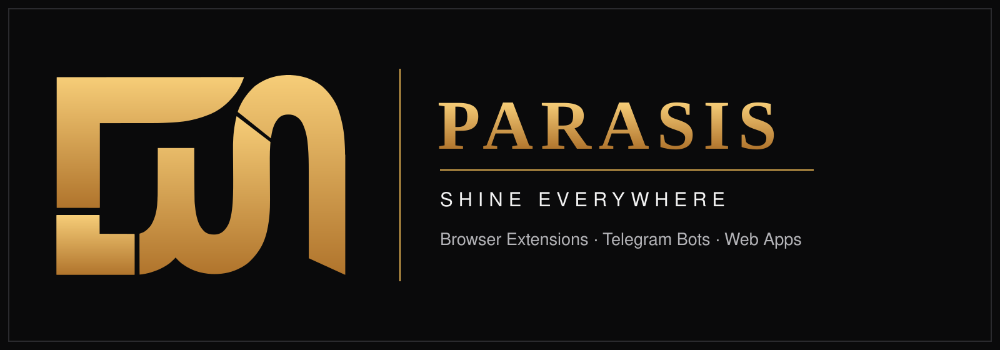

 

**Indie builder turning ideas into working products — with taste.**

---

## 👋 About me

I'm **Parham** — known online as **PARASIS**.

I design and ship digital products end-to-end: browser extensions, Telegram bots and web apps. I work with an AI-assisted ("vibe coding") workflow, but the bar is old-school: **a project is only finished when it is clean, documented and built to a professional standard** — real design systems, real structure, no generic templates.

- 🔭 Currently building **Sofreh** — a cooking app, designed to grow into a full product
- 🧩 My earlier personal tools are being cleaned, standardized and published here, one by one
- 🎨 Obsessed with interfaces that don't look like everyone else's
- 🤝 Open to interesting projects and collaborations
- 💬 Reach me fastest on [Telegram](https://t.me/PAPARISK)

## 👋 درباره من

من **پرهام** هستم — در فضای آنلاین با نام **PARASIS** فعالیت می‌کنم.

محصولات دیجیتال را از ایده تا اجرا می‌سازم: اکستنشن‌های مرورگر، ربات‌های تلگرامی و وب‌اپلیکیشن‌ها. روش کارم مدرن و مبتنی بر هوش مصنوعی است، اما معیارم کلاسیک است: **پروژه وقتی تمام است که تمیز، مستند و در استاندارد حرفه‌ای باشد** — با سیستم طراحی واقعی و ساختار درست، نه قالب‌های تکراری.

- 🔭 در حال ساخت **«سفره» (Sofreh)** — یک اپلیکیشن آشپزی که قرار است به یک محصول کامل تبدیل شود
- 🧩 ابزارهای شخصی قبلی‌ام در حال تمیزکاری و استانداردسازی‌اند و دونه‌دونه همین‌جا منتشر می‌شوند
- 🤝 برای پروژه‌ها و همکاری‌های جالب، درم باز است
- 💬 سریع‌ترین راه ارتباط: [تلگرام](https://t.me/PAPARISK)

---

## 🛠 What I build

| Area | What it means in practice |
| --- | --- |
| **Browser Extensions** | Chrome MV3 extensions with isolated sessions, custom theme systems and polished popups |
| **Telegram Bots & Automation** | Multi-account bots and automation with Python & Telethon |
| **Web Apps & Sites** | Modern, RTL-friendly interfaces with component-based design systems — never template-looking |

## 🧰 Toolbox

  

---

## 🚀 Now building — Sofreh

**[Sofreh](https://github.com/papagit-ss/Sofreh)** is my next product: a cooking app, starting small and designed to grow — recipes, planning and a proper Persian-first experience. It's the first of my projects to land on this profile, and the rest are on their way, one clean repository at a time.

**[«سفره»](https://github.com/papagit-ss/Sofreh)** محصول بعدی من است: یک اپلیکیشن آشپزی که کوچک شروع می‌شود و برای بزرگ شدن طراحی شده. اولین پروژه‌ای است که روی این پروفایل می‌نشیند؛ بقیه هم در راه‌اند — هر بار یک ریپوی تمیز و استاندارد.

---

**PARASIS — SHINE EVERYWHERE** ✦ همه‌جا بدرخش

